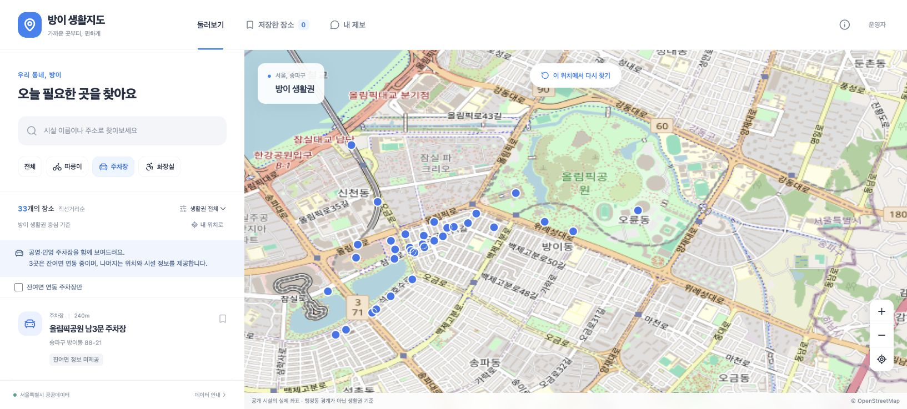
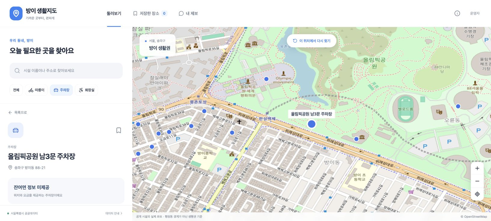

# 방이2동 3D 생활지도 고도화안

> 2026-10-11 작성한 초기 제안이다. 이후 3D GIS와 실사 지도 연동을 구현했고 2026-10-29 NCP 운영을 종료했다. 당시의 미구현 항목을 현재 상태로 해석하지 않는다. [소스 구현 범위](../README.md#구현된-기능)와 [운영 종료 기록](운영_종료.md)을 참고한다.

검토일: 2026-10-11. 현재 배포본 0.4.0의 화면과 코드를 확인하고 작성한 구현 제안이다. 이 문서 작성 시점에는 3D 전환을 배포하지 않았다.

## 판단

방이2동에 집중한 고품질 3D GIS 웹 구현은 가능하다. 실제 행정동 경계, 건물 외곽과 높이, 생활시설의 현재 상태를 연결하는 방향을 권장한다. 모델의 정밀도와 실시간 데이터의 범위는 각각 표시해야 한다. 건물을 입체로 표시하는 것만으로 모든 공간 상태를 재현하는 디지털트윈이 완성되지는 않는다.

송파구는 방이2동 면적을 0.8㎢로 안내한다. 이 범위에 집중하면 건물별 데이터 검수와 화면 완성도에 개발 시간을 쓸 수 있다. 법정동인 방이동 전체, 올림픽공원 전체, 기존 사각형 생활권을 방이2동으로 표시하지 않는다. [송파구 방이2동 소개](https://www.songpa.go.kr/www/contents.do?key=2511)

## 현재 화면에서 확인한 문제

Chrome의 실제 스테이징을 열어 `주차장 목록 → 시설 선택` 두 단계를 새로 캡처했다. 아래 이미지는 개편 시안이 아닌 현재 서비스다.

### 1. 주차장 목록과 지도 — 탐색 밀도 개선 필요

- 카테고리와 검색의 의미는 명확하다. 실시간 정보 미제공도 구분한다.
- 1,633×737 캡처에서 제목, 검색, 필터, 설명이 목록의 대부분을 차지해 장소 카드 한 개 정도만 보인다.
- 배경지도의 지명과 도로 표기가 강하고, 같은 색의 점들이 겹친다. 실제 방이2동 경계나 건물별 정보는 없다.
- 코드의 Cesium Viewer는 `SCENE2D`로 고정되어 있다. 현재는 3D 건물이나 지형을 불러오지 않는다.
- 작은 보조 문구와 점 중심 선택은 가독성과 조작 면적을 점검할 필요가 있다. 대비 비율이나 키보드 탐색에 대한 접근성 적합 판정은 이번 캡처만으로 하지 않았다.

### 2. 시설 선택과 상세 — 핵심 정보 배치 개선 필요

- 선택한 시설의 점과 이름이 강조되고 지도가 해당 위치로 이동한다. 데이터 출처와 미제공 상태가 상세에 있다.
- 상세 화면에서도 상단 검색 영역이 크게 남아 요금과 운영 정보, 길찾기는 첫 화면 아래로 밀린다.
- 점의 좌표만으로는 어느 건물이나 부지와 연결되는지 이해하기 어렵다. 3D 전환 시 건물과 시설을 구분해서 선택하고 서로 연결할 필요가 있다.
- 이번 진단은 데스크톱의 두 단계에 한정한다. 모바일, 스크린리더, 키보드만으로 전체 흐름을 완료하는 검증은 개편 후 별도 수행한다.

## 권장 화면

**밝고 정돈된 3D 도시 지도**를 기본으로 한다. 토스와 애플에서 참고할 점은 정보의 우선순위, 읽기 쉬운 문장, 예측 가능한 조작이다.

| 영역 | 구현 방향 |
| --- | --- |
| 기본 지도 | 실제 건물 외곽과 확보한 높이, 낮은 채도의 도로와 녹지, 방이2동 경계선. 처음에는 동 전체가 들어오는 사선 시점 |
| 상단 | 작은 서비스명, 통합 검색, `방이2동` 범위 표시. 큰 소개 문구는 안내 화면으로 이동 |
| 왼쪽 | 건물, 주차장, 따릉이, 화장실 레이어. 기본 표시 수를 제한하고 선택한 레이어만 강조 |
| 지도 표식 | 시설 종류를 아이콘으로 구분. 확대 수준에 따라 군집화하고 중요한 이름만 표시. 실시간 수량은 해당 레이어에서만 노출 |
| 오른쪽 | 선택 시 열리는 상세 패널. 이름, 현재 상태, 주요 속성, 다음 행동을 먼저 배치하고 출처와 세부사항은 접어서 제공 |
| 지도 조작 | 2D/3D 전환, 북쪽 정렬, 전체 보기, 확대/축소. 기울기와 회전 조작에 짧은 도움말 제공 |
| 모바일 | 지도와 연결되는 하단 시트. 한 손으로 선택 가능한 버튼과 높이 조절. 저성능 환경에는 2D 및 목록 제공 |

주요 흐름은 `방이2동 전체 조망 → 건물 또는 시설 검색 → 선택한 위치로 이동 → 상태와 주변 시설 확인`이다. 건물 선택 색과 시설 종류의 색을 구분하고, 상태는 색상 외에 숫자와 문구로도 전달한다. 자동 회전이나 지속적인 카메라 비행은 기본값으로 넣지 않는다.

## 데이터 확보 가능성과 확인할 조건

| 데이터 | 확인한 출처와 활용 | 구현 전 확인할 항목 |
| --- | --- | --- |
| 행정동 경계 | SGIS는 기준연도와 행정구역 코드로 경계 GeoJSON을 제공한다. 현재 문서에는 2025년까지 명시되어 있다 | 별도 API 인증, 최신 기준연도, 방이2동 코드, 좌표계. 센서스용 경계의 성격을 명시하고 송파구 자료와 대조 |
| 건물 외곽과 속성 | 국토교통부 GIS건물통합정보는 건물 공간정보와 건축물대장 속성을 결합한다. 도형은 별도 SHP 파일로도 제공 | 방이2동의 실제 파일 확보, 건물 식별자와 속성 결합률, 높이 및 층수 필드의 유효값 비율, 갱신일 |
| 사진 질감이 있는 3D 지도 | VWorld 공식 예제에서 WebGL 3D API 3.0과 Cesium 기반 모델 표시를 확인 | 별도 VWorld 키, 등록 도메인/localhost 허용 여부, 호출 정책, 재사용 조건, 방이2동 실제 커버리지와 품질 |
| 따릉이와 주차 | 현재 서울시 수집기와 제공 시각, 오래된 값 처리 로직 재사용 | 경계로 재분류한 내부 시설 수. 외부 시설은 기본 숨김 또는 별도 주변 레이어 |
| 지형 및 도로 | 건물과 지면의 높이 정합, 가독성 높은 배경에 필요 | 허용된 지형/배경 데이터 공급원, 출처 표기, 수직 기준과 해상도 |

근거: [SGIS 주소와 행정구역 경계 API](https://sgis.mods.go.kr/developer/html/newOpenApi/api/dataApi/addressBoundary.html), [국토교통부 GIS건물통합정보](https://www.data.go.kr/data/15029175/standard.do?recommendDataYn=Y), [VWorld 공식 2026년 3D 개발 예제](https://github.com/V-world/V-world_API_sample/blob/master/%EB%B8%8C%EC%9D%B4%EC%9B%94%EB%93%9C_%EA%B5%90%EC%9C%A1/2026%EB%85%84_%EB%B8%8C%EC%9D%B4%EC%9B%94%EB%93%9C_%EA%B5%90%EC%9C%A1/Readme.md)

이 검토에서 방이2동의 건물 도형 원본 전체와 높이 속성을 내려받아 검증한 것은 아니다. 자료 제공 경로를 확인한 상태이며, 전체 건물 수와 높이 확보율은 아직 확정할 수 없다. 서울 열린데이터광장 키를 SGIS나 VWorld 키로 사용할 수는 없다.

건물 높이는 출처에 있는 값, 층수로 추정한 값, 미확인을 구분한다. 추정이 필요하면 산식과 추정 표시를 제공하고 실제 높이처럼 노출하지 않는다. 높이와 층수가 모두 없는 건물은 외곽만 표시할 수 있다. 실물과 관계없는 임의의 박스를 채우지 않는다.

서울 S-Map은 3D 활용 사례로 참고할 수 있다. 다만 공개 뷰어에서 보이는 모델을 우리 서비스에 복사하거나 외부 서비스용 API로 쓸 수 있다고 가정하지 않는다. [서울시 S-Map 소개](https://news.seoul.go.kr/gov/archives/528155?listPage=1)

## 3D 방식 선택

**첫 구현은 건물 외곽과 높이를 이용하는 단순 입체 모델(LoD1)을 권장한다.** 데이터 검수, 건물 선택과 속성 표시, 색상과 강조 효과를 직접 관리할 수 있고 전송량도 제어하기 쉽다. 지붕의 세부 형태나 외벽의 실제 사진까지 재현하는 방식은 아니다.

VWorld의 3D 지도는 별도 검증 후 선택 가능한 표현 방식으로 검토한다. VWorld SDK가 사용하는 Cesium과 현재 npm Cesium을 한 화면에 중복 초기화하지 않는다. 공식 SDK를 격리한 지도 어댑터 또는 허용된 데이터 제공 방식으로 통합한다. 내부 타일 주소를 추측해서 직접 호출하는 방식은 사용하지 않는다.

외벽, 간판, 실내, 지하 공간까지 정밀하게 재현하려면 추가 모델이나 측량 자료가 필요하다. 모든 건물의 사진 수준 재현을 첫 버전의 완료 조건으로 삼지 않는다.

## 기능 우선순위

| 단계 | 사용자에게 제공할 결과 | 완료 조건 |
| --- | --- | --- |
| 1. 공간 기반 | 실제 방이2동 경계와 건물 3D, 2D/3D 전환, 검색과 선택 | 경계 출처와 연도 명시, 도형과 높이 검증, 선택 결과가 동일 건물 속성과 연결 |
| 2. 화면 개편 | 지도 중심 화면, 레이어, 상세 패널, 모바일 하단 시트 | 목록/지도/검색의 선택 상태 일치, 표식 겹침 완화, 모바일과 키보드 이용 검증 |
| 3. 상태 연결 | 범위 안 생활시설의 위치와 최신 수량, 수집 지연 안내 | 제공 시각과 수집 시각 구분, 미제공을 0으로 표시하지 않음, 외부 시설 분리 |
| 4. 공간 탐색 | 거리/면적 측정, 용도/높이별 보기, 시간에 따른 그림자 참고 보기 | 단위와 계산 의미 명시. 그림자는 검증된 입력 범위에서 시각적 참고 정보로 제공 |
| 5. 변화 기록 | 수집을 시작한 시점 이후 시설 상태 이력 | 보존기간과 누락 표시, 원본 제공 시각 기준 조회. 존재하지 않는 과거 데이터 생성 금지 |

현재 주차 데이터 중 실시간 잔여면을 받는 잠실역, 잠실나루역, 신천유수지 3곳의 주소는 모두 신천동이다. 이를 방이2동 내부의 실시간 주차장으로 제시하지 않는다. 방이2동 내부 실시간 주차 데이터가 없는 경우 그 사실을 안내한다. 최종 시설 수는 확보한 경계와 좌표로 판정한다.

보행 시간과 최적 경로는 보행 네트워크를 확보한 후 별도 기능으로 다룬다. 현재 직선거리를 도보 거리나 소요시간으로 바꾸어 표기하지 않는다. 건물 높이만으로 구조 안전, 실제 혼잡, 정밀 일조 영향을 판정하지 않는다.

## 기존 프로젝트에 적용할 구조

- React/TypeScript는 화면과 선택 상태를 맡고, Cesium은 실제 좌표 기반 3D 지도와 공간 선택을 담당한다.
- Java API와 PostGIS는 경계에 따른 시설/건물 조회, 속성, 수집 상태와 이력을 담당한다. 외부 API를 지도 이동마다 호출하지 않는다.
- 원본 건물 데이터의 좌표 변환, 도형 검증과 경량화는 개발 환경에서 수행한다. 용도에 맞게 GeoJSON, GLB 또는 3D Tiles로 생성하고 지역과 버전별로 보관한다.
- 건물 도형을 모두 React 컴포넌트로 만들지 않는다. 규모를 측정해 Cesium primitive 또는 3D Tiles로 묶고 확대 수준별로 상세도를 바꾼다.
- 정적인 3D 데이터는 버전별 캐시를 사용한다. 실시간 수량 갱신 시 건물 모델을 다시 만들지 않는다.
- 경계와 건물의 식별자, 원본 CRS, 제공일, 수집일, 높이 출처, 변환 버전을 기록한다. 좌표계와 지면 기준을 맞추고 도로/위성 배경과 여러 지점에서 대조한다.
- 현재 로그인, 제보, 저장 기능과 서울시 수집기는 재사용한다. 배포된 DB 마이그레이션은 수정하지 않고 후속 버전을 추가한다.

경계 판정은 화면의 사각형 범위나 주소에 포함된 문자열 대신 PostGIS 공간 연산을 사용한다. 경계를 가로지르는 건물의 포함 기준을 정하고, 지도 표현과 집계에 같은 규칙을 적용한다. 원본 경계는 보관하고 표시용 단순화 도형과 분리한다.

## NCP와 성능

초기에는 현재 NCP Micro 서버를 유지하는 구성으로 시작할 수 있다. 3D 렌더링은 사용자의 브라우저 GPU가 수행하며 서버는 API와 정적 파일을 제공한다. 이 사실이 Micro 서버의 용량과 처리량을 보장하지는 않는다. 건물 데이터 확보 후 파일 크기, 저장공간, 메모리와 전송량을 측정해야 한다.

NKS, GPU 서버, 별도 상용 3D 서비스는 첫 단계의 필수 요건이 아니다. 추가 비용이 생기는 저장소나 CDN은 실제 측정 후 판단한다. 원본 GIS 변환과 3D 타일 생성은 1GB 서버에서 실행하지 않는다.

다음 수치는 구현 후 확인할 목표이며 현재 달성값이 아니다.

- 데스크톱 일반 사용 환경에서 지도 조작 30fps 이상을 우선 목표로 설정한다. 장치와 브라우저를 기록해 측정한다.
- 첫 화면에 필요한 건물부터 순차적으로 표시하고 나머지는 시야와 확대 수준에 따라 불러온다.
- 숨긴 탭과 정지 화면의 렌더링을 줄인다. 모바일은 그림자와 상세도를 낮추고 WebGL 실패 시 2D/목록으로 전환한다.
- 키보드로 검색, 결과 선택, 상세 닫기와 지도 복귀가 가능해야 한다. 모션 감소 설정을 존중하고 작은 표식은 목록에서도 선택할 수 있게 한다.
- 외부 데이터 공급 실패, 높이 누락, 오래된 실시간 값, 결과 없음의 화면을 각각 확인한다.

## 착수 순서와 현재 산출물

첫 작업은 경계 1개와 실제 건물 표본을 확보해 **위치, 높이, 출처를 검증한 3D 장면**을 만드는 것이다. 이를 기준으로 화면 디자인을 정교화한 후 방이2동 전체와 생활시설을 연결한다. 표본 데이터가 검증되기 전에 임의의 건물로 완성 화면을 만드는 방식은 피한다.

이번에 완료한 것은 실제 화면 두 단계의 진단, 코드 구조 확인, 공식 데이터 경로 조사와 이 구현안 작성이다. 아직 완료하지 않은 것은 방이2동 경계/건물 원본 확보, VWorld 키 및 현지 3D 품질 검증, 화면 구현, 성능 검증과 배포다.

## 2026-10-11 구현 반영

0.5.0에서 실제 방이2동 경계, 건물 1,484개, 도로 404개, 공원 6곳과 학교 부지 1곳을 구현했다. 경계 출처는 SGIS 가공본, 건물과 도로는 Overture 2026-09-23.1이다. 높이를 얻지 못한 건물은 평면으로 남겼다. VWorld 인증키가 없어도 현재 공개 자료로 동작하며, VWorld의 사진 기반 모델이나 정밀 지형을 포함하지 않는다. 최종 확인 결과는 `검증_결과.md`, 재현 절차와 라이선스는 `../data/bangi2/SOURCES.md`를 따른다.
