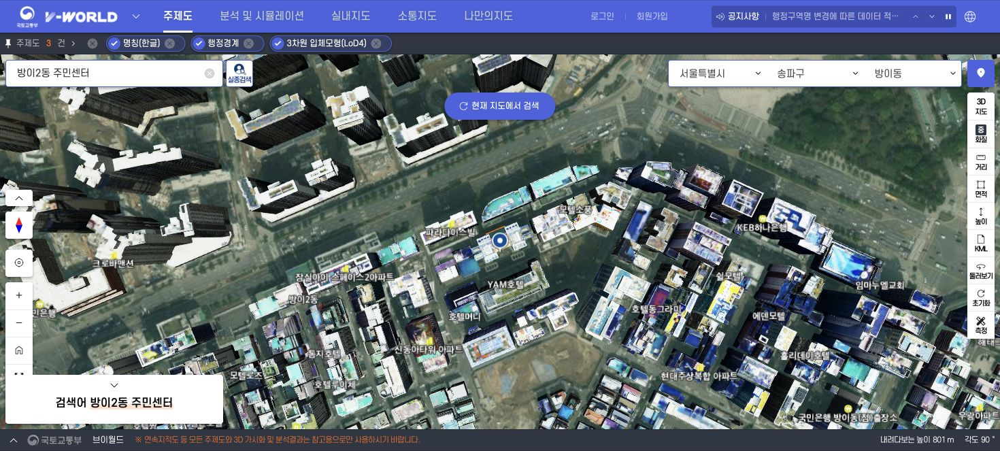

# 방이2동 외벽과 지붕을 표현하는 3D 지도

> 조사일 기준의 데이터/이용 조건 및 검증 기록이다. 2026-10-29 NCP 운영을 종료했으며 현재 서비스 제공이나 외부 API 키의 유효성을 보장하지 않는다. 재사용 시 제공처의 최신 조건을 확인한다. [운영 종료 기록](운영_종료.md)을 참고한다.

조사일: 2026-10-11. 구현 및 NCP 배포 검증: 2026-10-12. **웹 0.6.0에서 실사 3D 연동을 완료했고, 기존 Micro 서버에 배포했다.**

## 결론

브이월드 WebGL 3D API 3.0을 우선 채택한다. 공식 공개 지도에서 **방이2동 주민센터(올림픽로34길 5-13) 주변의 사진 질감이 있는 건물 외벽과 옥상**을 직접 확인했다. 사용자 승인을 받아 전용 무료 개발키를 발급하고 `https://localhost:8443`에서 SDK 연동, 실제 건물 로딩, 시설 좌표 선택을 검증했다. 서울 열린데이터광장 인증키와 별개다. 개발키 만료일은 2027-04-11이다.

아래는 우리 서비스의 구현 결과가 아니라 **브이월드 공식 지도에서 확인한 화면**이다. 제공 모형의 존재를 보여주며, 최신 건물 전체를 정확히 재현한다는 의미는 아니다.

출처: [브이월드 지도](https://map.vworld.kr/map/dtkmap.do?mode=MAPW201). `방이2동 주민센터` 검색 후 `3차원 입체모형(LoD4)` 레이어에서 확인. 촬영 시점, 건물별 갱신 시점, 방이2동 전체 커버리지와 누락률은 미확인이다.

## 무료 우선 비교

| 후보 | 실제 외벽과 지붕 | 비용과 키 | 이번 판단 |
| --- | --- | --- | --- |
| 브이월드 3D API 3.0 | 방이2동 주민센터 주변에서 텍스처와 옥상 모형 확인 | 공식 목록상 무료, 별도 브이월드 키 필요 | 실제 연결 및 배포 완료 |
| 현재 Overture 건물 | 외곽과 일부 높이만 있음. 방이2동 원본 1,484건의 외벽/지붕 속성은 모두 없음 | 무료 공개 데이터, 현재 자료는 키 불필요 | 기본 GIS와 건물 속성용 유지 |
| 서울 S-Map | 서울시 실사 3D 도시를 제공 | 공개 뷰어 열람 가능. 외부 서비스의 원본 재사용 권한과 공개 3D SDK 경로는 이번 조사에서 확보하지 못함 | 대안으로 남김. 뷰어 내부 타일을 복사하지 않음 |
| Google Photorealistic 3D Tiles | 전 세계 일부 지역의 실사 3D. 방이2동 제공 여부는 미확인 | 결제 계정, Map Tiles API 활성화, 별도 API 키 필요 | 무료 후보 검증 전에는 선택하지 않음 |
| 직접 촬영과 모델 제작 | 원하는 건물의 외관을 제작할 수 있음 | 촬영, 모델 제작, 이용권 확보 등 별도 작업과 비용 가능 | 무료 데이터의 품질 부족이 확인된 이후 검토 |

근거: [국토교통부 웹지엘 3D 지도 API, 무료 표시](https://www.data.go.kr/data/3073144/openapi.do), [Overture building 스키마](https://docs.overturemaps.org/schema/reference/buildings/building/), [서울시 S-Map 소개](https://news.seoul.go.kr/gov/archives/528155?listPage=1), [Google 공식 3D Tiles 안내](https://developers.google.com/maps/documentation/tile/3d-tiles).

## 현재 데이터 감사

`python3 scripts/audit-building-appearance.py`로 원본과 현재 제공 건물 ID를 대조했다. 1,484개 전부 원본과 연결된다. `facade_color`, `facade_material`, `roof_material`, `roof_shape`, `roof_direction`, `roof_orientation`, `roof_color`, `roof_height`는 각각 0건이다. 세부 결과: `evidence/realistic3d/building-appearance-audit.json`.

따라서 창문이나 지붕을 임의 생성해 실제 외관이라고 표시하지 않는다. 현재 LoD1 건물과 실사 모형은 출처와 의미가 다르므로 별도 표현 방식으로 제공한다.

## 브이월드 조건과 비용

- 공식 3D API 3.0은 HTTPS 로더를 제공한다. HTTPS 이용 시 등록 도메인을 `domain` 매개변수에 넣도록 안내한다. 별도 Cesium 배포본을 함께 로드할 필요가 없고 Cesium의 모든 기능이 지원되는 것은 아니다. [공식 가이드](https://www.vworld.kr/dev/v4dv_opnws3dmap3guide_s001.do)
- 공식 FAQ는 지오코더만 하루 4만 건 제한을 명시하고, 그 밖의 API에는 별도 일일 제한량이 없으나 과도한 호출 시 일시 차단될 수 있다고 안내한다. 무제한 성능 보장으로 해석하지 않는다. [API FAQ](https://www.vworld.kr/v4po_brdfaq_s001.do?bodIde=52)
- 개발키는 6개월, 최대 3회 연장 가능하고 운영키는 2년 후 연장 심사를 받는다는 안내를 확인했다. 이번 개발키는 등록 주소 `https://localhost:8443`에서 발급과 실제 지도 호출이 성공했다. 공개 운영 전에는 별도 서비스 주소와 운영키 심사를 확인해야 한다. NCP 방화벽은 변경하지 않았다.
- 공개 이용약관에는 출처 표기, 영리 목적 이용의 운영기관 동의, 3D 데이터의 무단 복제 및 저장 제한이 있다. 무료 API 이용과 원본 데이터의 무제한 재배포를 구분한다. 공식 SDK 스트리밍을 사용하고 원본 타일을 NCP로 대량 복사하지 않는다. [이용약관 제13·14·19·20조](https://www.vworld.kr/v4po_prcint_a001.do)
- 실제 발급 화면에 제시된 오픈API 약관을 읽고 사용자 승인을 받아 동의했다. 해당 약관 제10조는 상업적 이용에 별도 허락을, 제12조는 실시간 연동과 원본의 무단 저장 제한을 규정한다. 활용사례 공개에는 동의하지 않았다.

이번에 추가 유료 자원을 생성하거나 결제하지 않았다. SDK와 3D 데이터를 브이월드가 전송하고 브라우저가 렌더링하는 구성으로, **2026-10-12 당시 NCP Micro 서버에 배포를 완료했다**. 해당 서버는 2026-10-29 삭제했다. 성능을 측정하기 전 서버 증설은 필요하다고 판단하지 않는다. 지도 데이터량이 많으면 사용자의 네트워크와 GPU 부담은 커질 수 있다.

## 구현과 검증 결과

- `실사 3D / 기본 지도` 전환. 엔진은 하나씩 마운트하고 선택한 시설 또는 건물 위치를 전달한다.
- 실사 건물 위에 SGIS 방이2동 경계와 생활시설 표식을 표시한다. 기본 지도의 단순 돌출 건물을 겹쳐 그리지 않는다.
- 목록의 시설 선택과 실사 지도 카메라 이동, 시설 종류와 검색어 필터, 위에서/비스듬히 보기, 확대/축소를 연결했다.
- 실사 지도 클릭은 해당 좌표를 포함하는 Overture 외곽을 찾는다. 최근접 건물을 임의로 연결하지 않는다. 두 공급자의 건물 ID와 촬영/갱신 시점이 같다는 전제는 사용하지 않는다.
- SDK 스크립트와 데이터는 공식 브이월드 HTTPS 서버에서 직접 스트리밍한다. 원본 모형을 NCP에 저장하거나 프록시하지 않는다. React 문서의 CSP는 유지하고 SDK 문서에만 필요한 정책을 적용했다.
- 키가 없거나 SDK가 로드되지 않는 상태를 검증했다. 오류 안내에서 기본 지도로 복귀하는 것이 실제 Chrome에서 동작했다.
- 데스크톱과 390px 모바일 문서에서 시설 검색, 주민센터 상세와 실사 모형을 확인했다. 자동 뷰포트 기능이 적용되지 않아 로컬 테스트 전용 390×844 iframe을 사용했다. 기기별 GPU 성능 시험을 뜻하지 않는다.
- 코드 타입 검사, 프로덕션 빌드, 인증키/origin 검증 테스트 3개, 1,484개 공간 데이터 정합성 검증을 통과했다.
- 배포 후 TLS 인증, 웹/SDK 파일 일치, 엄격한 상위 CSP, 시설 30건과 실시간 수집 상태, 비로그인 운영자 API 거부, 컨테이너 상태를 확인했다. 근거: `evidence/realistic3d/staging-verification.json`.
- 첫 배포는 서버 내부 점검 CA가 과거 파일이어서 자동 롤백했다. 현재 승인된 CA를 점검 전용 파일에 넣은 뒤 재배포와 인증서 검증이 성공했다. 검증을 끄지 않았다.

추가 서버나 유료 API 상품을 생성하지 않았다. 배포 후 웹 메모리 약 3.5MiB, API 178MiB, DB 101MiB, 서버 가용 메모리 약 346MiB를 확인했다. 브이월드의 렌더링 비용은 사용자 브라우저/GPU와 네트워크에 의존한다.

### 확인된 범위와 한계

방이2동 주거 블록과 한성백제역, 주민센터 주변에서 외벽 텍스처와 지붕 모형이 표시됐다. 모든 1,484개 건물의 개별 모형, 촬영 연도, 최신성 및 누락률은 확인되지 않았다. 표시되는 모델의 생성 시점은 기본 GIS와 다를 수 있다. 창문이나 지붕을 AI로 만들어 실제 외관으로 표시하지 않았다.

개발키 만료 전 갱신이 필요하다. 공개 상업 서비스로 전환할 때는 운영키와 상업적 이용 허락을 별도로 확인해야 한다. 당시에는 승인된 비공개 개발 환경에서 검증했다.

## 2026-10-12 추가 확인

공식 LoD4 구축표에서 서울 전역의 2024년 구축을 확인했다. 개별 건물의 촬영일과 누락 수는 여전히 미확인이다. S-Map의 2025년 지도 조회를 확인했으나 원본은 별도 제공 신청과 심사 대상이다. 자세한 근거와 1,484개 도형 점검 결과는 [추가 점검 보고서](방이2동_실사데이터_누락과시점_점검.md)를 참조한다.
